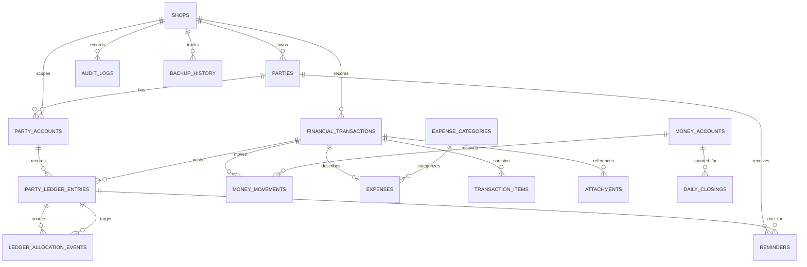

# 06 — Drift / SQLite Database Schema (V1)

**Product:** Smart Khata  
**Schema baseline:** `1`  
**Storage:** SQLite managed through Drift  
**Currency:** INR, integer paise  
**Data model:** Single local shop in V1; `shop_id` retained on business tables for future-safe ownership scoping  
**Status:** Proposed canonical schema for implementation review

---

## 1. Schema design decisions

1. **SQLite is the V1 source of truth.** UI state and cached totals are projections only.
2. Persist money as signed 64-bit integer paise. Never use `REAL`, `double` or floating point for money.
3. A posted financial event is append-only. Corrections use a new reversal transaction and reversal ledger entries.
4. A party can have customer and supplier roles. Those roles have separate `party_accounts` and balances.
5. A ledger entry's signed amount is interpreted relative to that party account: positive increases the balance the party owes the shop; negative decreases it / creates or increases an advance.
6. Customer receivable and supplier payable use the same sign convention but are never netted across roles.
7. Payments can settle several open entries and can leave an advance. Allocations are explicit and reversible through allocation events.
8. Money-account movement is separate from party-ledger movement. Payment method (cash/UPI/bank transfer) is separate from destination account (cash drawer/bank/UPI settlement account).
9. A customer receipt/supplier payment and its account movement must commit atomically.
10. IDs are UUID strings generated by the application. Every write operation that may be retried has a unique `operation_id`.
11. All timestamps are UTC epoch milliseconds. A business date is stored separately as ISO `YYYY-MM-DD` where needed for daily closing.
12. Foreign keys are enabled. Financial data is not physically deleted.

## 2. Entity relationship overview



## 3. Tables and canonical columns

### 3.1 `shops`

| Column | SQLite type | Rules |
|---|---|---|
| `id` | TEXT | PK, UUID |
| `name` | TEXT | NOT NULL, trimmed non-empty |
| `owner_name` | TEXT | nullable |
| `phone` | TEXT | nullable, normalized separately by application |
| `address` | TEXT | nullable |
| `locality` | TEXT | nullable |
| `locale_code` | TEXT | NOT NULL, `en` or `te`, default `en` |
| `currency_code` | TEXT | NOT NULL, fixed `INR` in V1 |
| `time_zone` | TEXT | NOT NULL, IANA timezone configured during setup; default device timezone |
| `created_at` | INTEGER | NOT NULL, UTC epoch ms |
| `updated_at` | INTEGER | NOT NULL, UTC epoch ms |

V1 application invariant: exactly one active shop. Do not build shop-switching UI.

### 3.2 `parties`

| Column | SQLite type | Rules |
|---|---|---|
| `id` | TEXT | PK, UUID |
| `shop_id` | TEXT | FK → shops.id, NOT NULL |
| `display_name` | TEXT | NOT NULL |
| `normalized_name` | TEXT | NOT NULL, normalized search form |
| `primary_phone` | TEXT | nullable |
| `normalized_phone` | TEXT | nullable, indexed; not unique because family/shared phones are possible |
| `alternate_phone` | TEXT | nullable |
| `address` | TEXT | nullable |
| `locality` | TEXT | nullable |
| `notes` | TEXT | nullable |
| `customer_credit_limit_paise` | INTEGER | nullable, >= 0 |
| `status` | TEXT | NOT NULL, `active` / `archived` |
| `created_at` | INTEGER | NOT NULL |
| `updated_at` | INTEGER | NOT NULL |
| `archived_at` | INTEGER | nullable |

### 3.3 `party_accounts`

One row per party role. A party can have both a customer account and a supplier account.

| Column | SQLite type | Rules |
|---|---|---|
| `id` | TEXT | PK |
| `shop_id` | TEXT | FK → shops.id, NOT NULL |
| `party_id` | TEXT | FK → parties.id, NOT NULL |
| `role` | TEXT | NOT NULL, `customer` / `supplier` |
| `created_at` | INTEGER | NOT NULL |

Unique constraints: `(party_id, role)` and `(id, shop_id)`. Composite FK `(party_id, shop_id)` references `parties(id, shop_id)` so a party account cannot cross shop boundaries.

### 3.4 `financial_transactions`

This is the immutable transaction header. One business event may have a party ledger entry, money movement(s), expense detail, items or attachments.

| Column | SQLite type | Rules |
|---|---|---|
| `id` | TEXT | PK |
| `shop_id` | TEXT | FK → shops.id, NOT NULL |
| `party_account_id` | TEXT | nullable FK → party_accounts.id; composite FK with shop_id enforces shop scope |
| `transaction_type` | TEXT | NOT NULL, controlled enum described below |
| `amount_paise` | INTEGER | NOT NULL, > 0 |
| `effective_at` | INTEGER | NOT NULL, UTC epoch ms of business event |
| `recorded_at` | INTEGER | NOT NULL, UTC epoch ms when entered |
| `business_date` | TEXT | NOT NULL, ISO `YYYY-MM-DD` in shop timezone at posting |
| `description` | TEXT | nullable |
| `reference_number` | TEXT | nullable |
| `operation_id` | TEXT | NOT NULL, UNIQUE; idempotency key |
| `related_transaction_id` | TEXT | nullable FK → financial_transactions.id (e.g. payment linked to purchase) |
| `reversal_of_transaction_id` | TEXT | nullable FK → financial_transactions.id; unique non-null (one full reversal) |
| `created_at` | INTEGER | NOT NULL |

Transaction type enum V1:

- `opening_balance`
- `customer_credit`
- `customer_payment`
- `customer_sales_return`
- `customer_refund`
- `supplier_purchase`
- `supplier_payment`
- `supplier_purchase_return`
- `supplier_refund`
- `expense`
- `cash_adjustment`
- `bank_adjustment`
- `party_adjustment`
- `transaction_reversal`
- `customer_refund`
- `supplier_refund`

Direction is not inferred from amount alone. The transaction type determines which linked ledger/movement rows are required; the row-level signed amount/direction records the exact effect.

### 3.5 `party_ledger_entries`

| Column | SQLite type | Rules |
|---|---|---|
| `id` | TEXT | PK |
| `shop_id` | TEXT | FK → shops.id, NOT NULL |
| `party_account_id` | TEXT | FK → party_accounts.id, NOT NULL; composite FK with shop_id |
| `transaction_id` | TEXT | FK → financial_transactions.id, NOT NULL; composite FK with shop_id |
| `entry_kind` | TEXT | NOT NULL, controlled enum: `opening`, `charge`, `payment`, `return`, `adjustment`, `reversal` |
| `amount_paise` | INTEGER | NOT NULL, non-zero signed integer |
| `due_at` | INTEGER | nullable UTC epoch ms |
| `created_at` | INTEGER | NOT NULL |

Unique `(transaction_id, party_account_id)` unless a future event explicitly requires multiple ledger lines for the same account; if so, add a line sequence and revise this constraint through a migration.

Balance = `SUM(amount_paise)` for a party account. Positive means party owes shop for both customer receivable and supplier payable. Negative means an advance/credit held for the party.

### 3.6 `ledger_allocation_events`

Allocation is event-based so it can be reversed without deleting history.

| Column | SQLite type | Rules |
|---|---|---|
| `id` | TEXT | PK |
| `shop_id` | TEXT | FK → shops.id, NOT NULL |
| `party_account_id` | TEXT | FK → party_accounts.id, NOT NULL; scopes both entries |
| `source_entry_id` | TEXT | FK → party_ledger_entries.id, NOT NULL; normally negative settlement/return entry |
| `target_entry_id` | TEXT | FK → party_ledger_entries.id, NOT NULL; positive charge entry |
| `event_type` | TEXT | NOT NULL, `allocate` / `release` |
| `amount_paise` | INTEGER | NOT NULL, > 0 |
| `reverses_event_id` | TEXT | nullable FK → ledger_allocation_events.id; required for `release`, null for `allocate` |
| `created_at` | INTEGER | NOT NULL |

Domain invariants:
- `party_account_id` is stored on each allocation event; composite foreign keys enforce source and target belong to that same party account and shop.
- Source entry amount is negative; target entry amount is positive.
- Net allocations against a source cannot exceed its absolute amount.
- Net allocations against a target cannot exceed its positive amount.
- Release event must reference an active allocation event and cannot release more than its remaining allocation.
- When reversing a source or target transaction, release affected allocations first, then insert reversal entries.
- Oldest-first is the default allocation policy; manual allocation is allowed.

### 3.7 `money_accounts`

| Column | SQLite type | Rules |
|---|---|---|
| `id` | TEXT | PK |
| `shop_id` | TEXT | FK → shops.id, NOT NULL |
| `name` | TEXT | NOT NULL |
| `account_type` | TEXT | NOT NULL, `cash` / `bank` / `upi_settlement` / `other` |
| `opening_balance_paise` | INTEGER | NOT NULL; signed integer if overdraft/negative opening is supported, otherwise enforce >= 0 in V1 |
| `opening_effective_at` | INTEGER | NOT NULL |
| `is_active` | INTEGER | NOT NULL, 0/1 |
| `created_at` | INTEGER | NOT NULL |

The table has a unique `(id, shop_id)` parent key so movements and closings can enforce same-shop references. Create a default `Cash` account during shop setup. Opening balance is frozen after initial posting; changes require a separate adjustment transaction.

### 3.8 `money_movements`

| Column | SQLite type | Rules |
|---|---|---|
| `id` | TEXT | PK |
| `shop_id` | TEXT | FK → shops.id, NOT NULL |
| `transaction_id` | TEXT | FK → financial_transactions.id, NOT NULL; composite FK with shop_id |
| `money_account_id` | TEXT | FK → money_accounts.id, NOT NULL |
| `payment_method` | TEXT | NOT NULL: `cash` / `upi` / `bank_transfer` / `cheque` / `other` |
| `direction` | TEXT | NOT NULL: `inflow` / `outflow` |
| `amount_paise` | INTEGER | NOT NULL, > 0 |
| `reference_number` | TEXT | nullable |
| `created_at` | INTEGER | NOT NULL |

A payment can have multiple movement rows (e.g. ₹500 cash + ₹500 UPI). Domain validation ensures sum of split movements equals transaction header amount. Cash account balance = opening balance + inflows − outflows.

### 3.9 `expense_categories`

`id TEXT PK`, `shop_id TEXT FK NOT NULL`, `name TEXT NOT NULL`, `normalized_name TEXT NOT NULL`, `is_default INTEGER NOT NULL`, `is_active INTEGER NOT NULL`, `created_at INTEGER NOT NULL`, `updated_at INTEGER NOT NULL`.

Unique active category names per shop should be enforced by application or a partial unique index on `(shop_id, normalized_name)` where active = 1.

### 3.10 `expenses`

`id TEXT PK`, `shop_id TEXT FK NOT NULL`, `transaction_id TEXT NOT NULL UNIQUE FK → financial_transactions.id`, `category_id TEXT FK → expense_categories.id`, `category_name_snapshot TEXT NOT NULL`, `payee TEXT NULL`, `note TEXT NULL`, `created_at INTEGER NOT NULL`.

The expense transaction has an outflow `money_movement`. Category name snapshot preserves historical readability if category is renamed/archived.

### 3.11 `transaction_items` (optional V1.1-ready table)

`id TEXT PK`, `shop_id TEXT FK NOT NULL`, `transaction_id TEXT FK NOT NULL` (composite with `shop_id`), `description TEXT NOT NULL`, `quantity_micros INTEGER NOT NULL CHECK >= 0`, `unit_name TEXT NULL`, `unit_price_paise INTEGER NOT NULL CHECK >= 0`, `line_total_paise INTEGER NOT NULL CHECK >= 0`, `line_number INTEGER NOT NULL`.

These are informational only; no stock quantity is changed in V1. When item lines are present, app validates their total equals transaction amount (or clearly labels them as partial description). Do not implement inventory side effects through this table.

### 3.12 `attachments`

`id TEXT PK`, `shop_id TEXT FK NOT NULL`, `transaction_id TEXT FK NOT NULL` (composite with `shop_id`), `relative_path TEXT NOT NULL UNIQUE`, `mime_type TEXT NOT NULL`, `size_bytes INTEGER NOT NULL CHECK > 0`, `sha256 TEXT NOT NULL`, `created_at INTEGER NOT NULL`.

Store files in app-private storage; export and restore them with the database. Validate path traversal and checksum. Never trust a path supplied by a backup archive.

### 3.13 `reminders`

`id TEXT PK`, `shop_id TEXT FK NOT NULL`, `party_id TEXT FK NULL` (composite with `shop_id`), `source_ledger_entry_id TEXT FK NULL` (composite with `shop_id`), `reminder_type TEXT NOT NULL` (`customer_due`, `supplier_due`, `backup`), `scheduled_at INTEGER NOT NULL`, `notification_id INTEGER NOT NULL`, `status TEXT NOT NULL` (`scheduled`, `cancelled`, `triggered`, `share_sheet_opened`), `created_at INTEGER NOT NULL`, `updated_at INTEGER NOT NULL`.

Do not use a `delivered` status for WhatsApp/SMS in V1. Opening the share sheet is not proof of message delivery.

### 3.14 `daily_closings`

`id TEXT PK`, `shop_id TEXT FK NOT NULL`, `money_account_id TEXT FK NOT NULL`, `business_date TEXT NOT NULL` (`YYYY-MM-DD`), `expected_cash_paise INTEGER NOT NULL`, `counted_cash_paise INTEGER NOT NULL`, `variance_paise INTEGER NOT NULL`, `denomination_counts_json TEXT NOT NULL`, `note TEXT NULL`, `revision_number INTEGER NOT NULL CHECK > 0`, `supersedes_closing_id TEXT NULL FK → daily_closings.id`, `created_at INTEGER NOT NULL`.

A new closing revision supersedes the previous one; don't update the old snapshot. Only one current revision per `(money_account_id, business_date)` should be treated as current by app query/revision logic.

### 3.15 `audit_logs`

`id TEXT PK`, `shop_id TEXT FK NOT NULL`, `entity_type TEXT NOT NULL`, `entity_id TEXT NOT NULL`, `action TEXT NOT NULL`, `reason TEXT NULL`, `metadata_json TEXT NULL`, `created_at INTEGER NOT NULL`.

Metadata must not contain PINs, passwords, encryption keys, full backup secrets or unnecessary personal data. Financial transaction/ledger/movement content is preserved in the append-only financial tables; audit logs explain who/why at the application level.

### 3.16 `backup_history`

`id TEXT PK`, `shop_id TEXT FK NOT NULL`, `backup_id TEXT NOT NULL UNIQUE`, `schema_version INTEGER NOT NULL`, `app_version TEXT NOT NULL`, `created_at INTEGER NOT NULL`, `record_counts_json TEXT NOT NULL`, `checksum_sha256 TEXT NOT NULL`, `destination_label TEXT NULL`, `status TEXT NOT NULL` (`created`, `verified`, `failed`), `failure_code TEXT NULL`.

Do not store backup passphrases, key material or raw filesystem paths in this table.

### 3.17 `app_settings`

`key TEXT PRIMARY KEY`, `value TEXT NOT NULL`, `updated_at INTEGER NOT NULL`.

Only non-secret preferences (locale, date display preference, onboarding completion, reminder preferences). Do not store PINs, passwords or cryptographic keys here.

---

## 4. Canonical V1 transaction effects

| Transaction type | Party ledger entry | Money movement |
|---|---|---|
| Customer credit | positive customer entry | none |
| Customer payment | negative customer entry | one or more inflows |
| Customer sales return | negative customer entry | none; if money is actually refunded, add linked `customer_refund` transaction with positive customer entry and outflow |
| Supplier purchase | positive supplier entry | none unless paid-now linked supplier payment |
| Supplier payment | negative supplier entry | one or more outflows |
| Supplier purchase return | negative supplier entry | none; if money is actually refunded by supplier, add linked `supplier_refund` transaction with positive supplier entry and inflow |
| Customer refund | positive customer entry (reduces customer advance/credit owed) | one or more outflows |
| Supplier refund | positive supplier entry (reduces supplier advance) | one or more inflows |
| Expense | none | one or more outflows |
| Opening customer/supplier balance | signed party entry | none |
| Party adjustment | signed party entry | none unless actual cash/bank movement occurs |
| Cash/bank adjustment | none | inflow/outflow movement with reason |

**Important:** a sale/credit does not automatically represent cash received; a purchase does not automatically represent cash paid. Do not count both the ledger event and the payment twice.

## 5. Balance and allocation calculations

### 5.1 Party account balance

`party_balance_paise = SUM(party_ledger_entries.amount_paise)` for the account.

- Positive customer account: customer owes shop.
- Negative customer account: customer advance.
- Positive supplier account: shop owes supplier.
- Negative supplier account: supplier advance.

### 5.2 Open amount for an individual charge

For a positive target ledger entry:

`open_amount = target_amount - net_active_allocations_to_target`

### 5.3 Available advance/settlement amount

For a negative source ledger entry:

`unallocated_amount = ABS(source_amount) - net_active_allocations_from_source`

Net active allocation = sum(`allocate`) − sum(`release`) for source/target pair, with release events tied to an allocation event.

### 5.4 Aging

Age each remaining open amount from that charge's `due_at`; if due date is absent, use the documented fallback (effective business date). Do not age from the party's most recent transaction. Keep advances in a separate section.

### 5.5 Running balance ordering

Use stable ordering: `effective_at ASC`, then `recorded_at ASC`, then transaction/entry ID ASC. A backdated transaction changes historical running balances; show the effective date and recorded date in detail to make that transparent.

## 6. Required indexes

- `parties(shop_id, normalized_name)`
- `parties(shop_id, normalized_phone)`
- `parties(shop_id, status)`
- `party_accounts(shop_id, role, party_id)` and unique `(party_id, role)`
- `financial_transactions(shop_id, effective_at DESC)`
- `financial_transactions(party_account_id, effective_at DESC)`
- unique `financial_transactions(operation_id)`
- unique non-null `financial_transactions(reversal_of_transaction_id)`
- `party_ledger_entries(party_account_id, created_at DESC)`
- `party_ledger_entries(party_account_id, due_at)`
- `ledger_allocation_events(source_entry_id, created_at)`
- `ledger_allocation_events(target_entry_id, created_at)`
- `money_movements(money_account_id, created_at DESC)`
- `money_movements(transaction_id)`
- `expenses(shop_id, created_at DESC)`
- `reminders(shop_id, status, scheduled_at)`
- `daily_closings(money_account_id, business_date, revision_number DESC)`
- `audit_logs(entity_type, entity_id, created_at DESC)`

## 7. SQLite integrity controls

Enable foreign keys on every connection (`PRAGMA foreign_keys = ON`). Use WAL mode where supported and choose a durability setting appropriate for financial records (review `synchronous=FULL` and performance on target devices). Run `PRAGMA integrity_check` as part of restore verification and support diagnostics.

Recommended triggers:
- Validate allocation source is negative and target is positive.
- Ensure net allocations cannot exceed source settlement or target charge amounts; each release must reference an active allocation event.
- Block UPDATE/DELETE on `financial_transactions`.
- Block UPDATE/DELETE on `party_ledger_entries`.
- Block UPDATE/DELETE on `money_movements`.
- Block UPDATE/DELETE on `ledger_allocation_events`.

Corrections are appended as new rows. If a bug requires data repair, ship a versioned migration with an explicit audit record; do not provide an unrestricted edit path in the UI.

SQLite CHECK constraints should enforce positive header amounts, non-zero signed ledger entries, valid enum strings, non-negative item quantities, valid status values and valid allocation amounts. Cross-row allocation constraints require a repository/domain transaction because ordinary CHECK constraints cannot query other rows.

## 8. Drift implementation guidance

Use Drift generated table classes for typed reads/writes and migration management. The canonical SQL constraints/indexes/triggers in this document must be represented in Drift table definitions and migration `customStatement` calls where the Drift table API does not express them.

Recommended code layout:

```text
lib/core/database/
├── app_database.dart
├── app_database.g.dart          # generated; never hand-edit
├── tables/
│   ├── shops.dart
│   ├── parties.dart
│   ├── party_accounts.dart
│   ├── financial_transactions.dart
│   ├── party_ledger_entries.dart
│   ├── ledger_allocation_events.dart
│   ├── money_accounts.dart
│   ├── money_movements.dart
│   ├── expenses.dart
│   ├── expense_categories.dart
│   ├── attachments.dart
│   ├── reminders.dart
│   ├── daily_closings.dart
│   ├── audit_logs.dart
│   ├── backup_history.dart
│   └── app_settings.dart
├── daos/
│   ├── parties_dao.dart
│   ├── ledger_dao.dart
│   ├── payments_dao.dart
│   ├── cash_book_dao.dart
│   └── reports_dao.dart
└── migrations/
    ├── migration_strategy.dart
    └── schema_v1_constraints.dart
```

Use DAOs for database queries, repositories for domain-facing operations, and use cases for business validation. BLoCs must not contain SQL.

### Migration policy

- Set `schemaVersion = 1` for the first public schema.
- Before public release, test fresh install and upgrade from every internally released schema version.
- Use Drift migration tests; do not rely only on manual upgrade testing.
- Use additive migration when possible; never drop financial data to simplify a migration.
- Backup before risky migrations and validate row counts and balances after migration.
- Schema downgrade is not supported; restore from a compatible backup or install a forward fix.

## 9. Atomic write contracts

### Customer payment

Within one Drift transaction:
1. Check unique `operation_id` (idempotent retry).
2. Validate selected party account is customer role and belongs to current shop.
3. Insert `financial_transactions` header.
4. Insert one negative `party_ledger_entries` row.
5. Insert allocation events (oldest-first or manual); leave remainder as advance.
6. Insert one or more inflow `money_movements`; total must equal transaction amount.
7. Insert audit log.
8. Commit.

If any step fails, rollback the whole operation.

### Supplier payment

Same contract with supplier role and outflow movements.

### Supplier purchase with paid-now amount

Within one transaction:
1. Insert purchase transaction and positive supplier ledger entry.
2. If paid-now > 0, insert linked supplier payment transaction and negative supplier ledger entry.
3. Allocate payment to purchase entry.
4. Insert supplier payment outflow movement(s).
5. Commit all or rollback all.

### Expense

Insert expense transaction, expense detail and outflow money movement(s) atomically.

### Reversal

1. Check source transaction exists and is not already reversed.
2. Find all allocation events affected by source/target entries and append release events for active amounts.
3. Insert reversal transaction referencing source.
4. Insert exact opposite party ledger entry and/or money movements for every affected source effect.
5. Insert audit log with required reason.
6. Commit atomically.

## 10. Backup format and restore contract

Backup is a versioned archive, not a raw file copied while SQLite is writing.

Manifest fields:
- `backup_format_version`
- `app_version`
- `schema_version`
- `created_at_utc`
- `shop_id`
- `record_counts`
- `database_sha256`
- `attachments_manifest` (relative paths, sizes and checksums)
- encryption algorithm/KDF metadata (never the secret key)

V1 requires a portable owner-controlled recovery method (for example passphrase-derived encryption key using a vetted, reviewed implementation). A device-bound Keystore key alone is insufficient for a backup intended to restore to a replacement phone. Do not implement custom cryptography. Keep a verified pre-restore backup and stage restored data separately before switching active database.

Restore checks:
1. File size/type and archive path validation.
2. Passphrase/key derivation and authenticated decryption.
3. Manifest version and required fields.
4. Checksums for database and attachments.
5. SQLite integrity check.
6. Foreign-key check.
7. Recompute party balances and money-account balances.
8. Compare reconciliation results with manifest summary.
9. Preview shop name/date/record counts.
10. Create pre-restore backup, then replace active DB atomically.

## 11. Open decisions requiring engineering spike before schema freeze

- Final cryptographic backup package and portable recovery UX.
- Whether V1 exposes multiple money accounts or only Cash + one optional Bank/UPI account.
- Whether partial cash refunds/returns are required in initial pilot.
- Whether Telugu PDF output is generated using an embeddable licensed font.
- Exact supported Android minimum version after device-market validation.

These decisions do not change the ledger principles but may add a migration before public release. Do not mark schema frozen until these spikes and merchant validation are completed.
